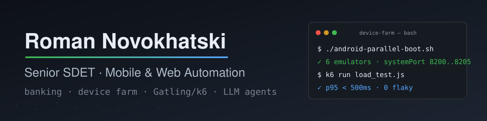

  

**Senior SDET** — автоматизация web и мобильных приложений: Java · Selenide · Appium · CI/CD.
Банковские продукты, тестовая инфраструктура, device farm, нагрузочное тестирование.

  
  

  

- 🔭 Сейчас: Senior QA Automation Engineer в **Приорбанке** — автоматизация для 6 банковских проектов (web, Android, iOS)
- ✍️ Пишу про мобильную инфраструктуру тестирования: [**Medium**](https://medium.com/@rnovokhatski) (серия: параллельные эмуляторы в CI, WebDriverAgent, flaky-тесты) · [**Tproger**](https://tproger.ru/articles/odin-frejmvork-dlya-android-i-ios-zvuchit-kruto-rabotaet-net)
- 🤖 Побочно — LLM-агенты: [ai-advent-agent](https://github.com/romaminsk/ai-advent-agent) (Java 21, Ollama, CI), [mailru-ai-assistant](https://github.com/romaminsk/mailru-ai-assistant) (OCR → AI → SQLite)
- 🏆 Конкурс «Лучший по профессии», номинация «Высшая лига» (2025, Приорбанк)
- 📫 [LinkedIn](https://www.linkedin.com/in/roman-novokhatski)

## Последние статьи на Medium

## Избранные репозитории

| Репозиторий | Что это |
|---|---|
| [mobile-parallel-runner](https://github.com/romaminsk/mobile-parallel-runner) | Параллельные прогоны мобильных тестов: Android-эмуляторы + iOS-симуляторы, Appium-серверы на выделенных портах — практика из серии статей |
| [ai-advent-agent](https://github.com/romaminsk/ai-advent-agent) | Консольный агент-чат с LLM: Java 21, OpenAI-совместимый эндпоинт, офлайн через Ollama, RAG-индекс, учёт токенов, CI |
| [mailru-ai-assistant](https://github.com/romaminsk/mailru-ai-assistant) | Учёт расходов из чеков Mail.ru: OCR → облачный AI → SQLite, Streamlit |
| [bankstart](https://github.com/romaminsk/bankstart) | Калькулятор финансовой устойчивости бизнеса (Monte Carlo), Java |
| [jpetstore-gatling-load-test](https://github.com/romaminsk/jpetstore-gatling-load-test) | Нагрузочное тестирование JPetStore (Gatling) |
| [k6-homework](https://github.com/romaminsk/k6-homework) | k6: пользовательский сценарий WebTours + ступенчатая нагрузка (ramping-arrival-rate) |

<picture>
  <source media="(prefers-color-scheme: dark)" srcset="https://raw.githubusercontent.com/romaminsk/romaminsk/output/github-contribution-grid-snake-dark.svg" />
  <source media="(prefers-color-scheme: light)" srcset="https://raw.githubusercontent.com/romaminsk/romaminsk/output/github-contribution-grid-snake.svg" />
  
</picture>

---

*English: Senior SDET (Java / Selenide / Appium) in banking. I write about mobile test infrastructure on Medium and build LLM agents on the side.*
